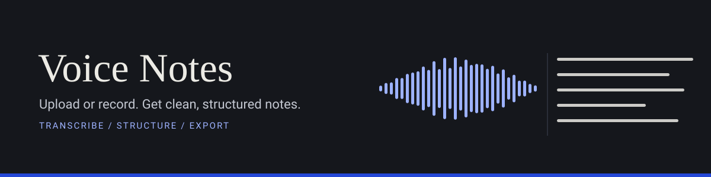
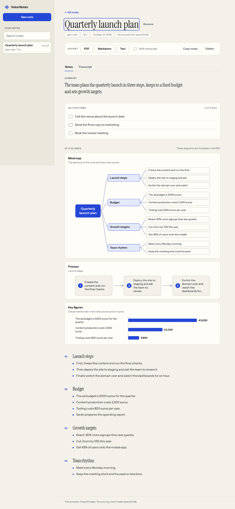
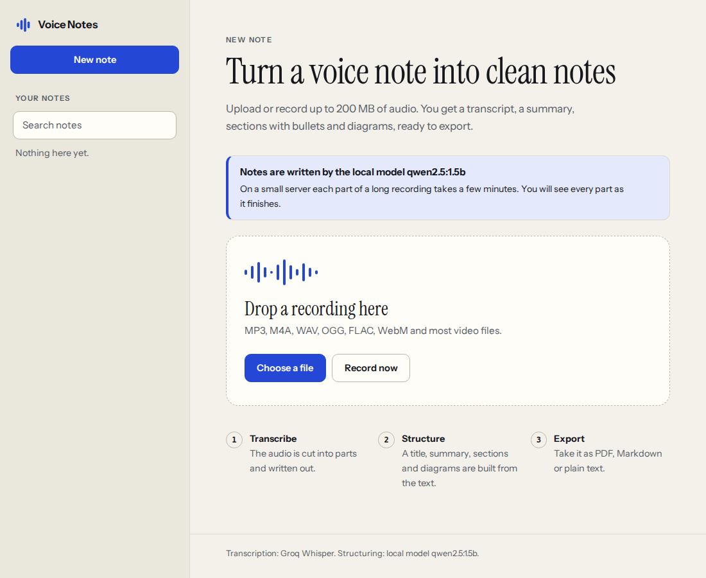
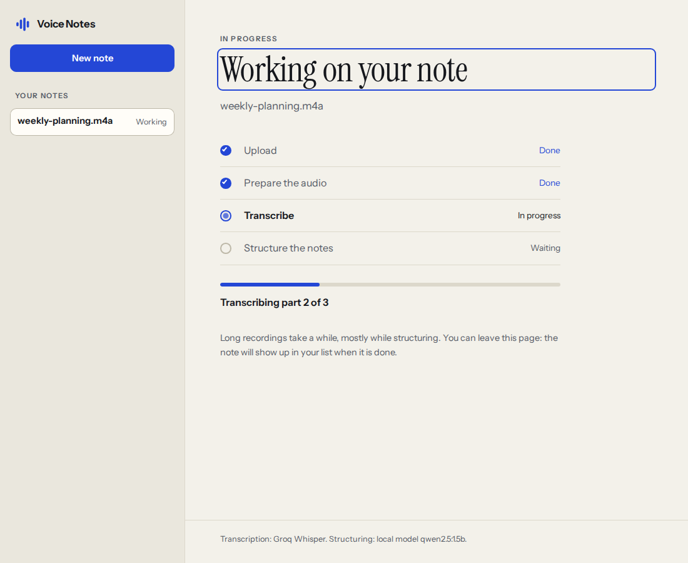
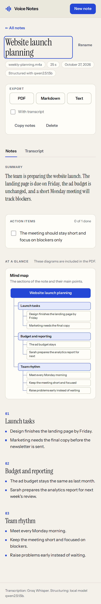

<p align="center">
  
</p>

# Voice Notes

A small web app that turns a voice note into written notes. You upload a recording, it is transcribed with Groq's Whisper API, a strong chat model on Groq (with a small local model and a rule-based fallback as backups) rewrites the text into clean notes with a title, a short summary, headings and bullets that you can share with a team or classmates, and you export the result as PDF, plain text or Markdown.

I built it for my own use: I record ideas while walking, and I want to find clean notes on my laptop afterwards instead of a 12 minute audio file.

<p align="center">
  
</p>

## Features

- Upload audio or video files up to 200 MB (MP3, M4A, WAV, OGG, FLAC, WebM, MP4 and more), by drag and drop or file picker, or record straight from the browser (needs https or localhost for microphone access).
- Long recordings are converted and split with ffmpeg into chunks well under Groq's 25 MB free tier limit, transcribed one by one and joined. Chunks are cut in the quiet gaps between words, so no word is split in two; when there is no gap, the next chunk starts two seconds early and the repeated words are removed when the texts are joined.
- Notes written by a strong chat model on Groq (`llama-3.3-70b-versatile` by default): speech is rewritten into proper sentences, fillers, stutters and false starts are removed, and nothing is invented. If Groq cannot be used, the small local model served by Ollama writes the notes, and if that is not available either, a rule-based fallback still produces a title, summary, key points, sections and action items. The status card on the start page, the progress page and the result say which engine was used and, when it was not the first choice, why. If a model fails on one part of a long note, only that part falls back to the rules. See "How the notes are built" below.
- Language of the recording: a selector on the start page (Auto, English, French, Arabic, Spanish, German, Italian, Portuguese, Turkish, Chinese). Auto lets Whisper detect the language; a chosen language is given to Whisper and to the notes prompt, so the notes are written in that language and never translated. The language is stored with the note and shown on the result.
- Key points: the three to five things a reader must not miss (decisions, deadlines, figures, the stated priority) in a card above the action items, in the PDF and in the text exports. Older notes get them too, computed from their own bullets.
- Rebuild notes: a finished note can be written again from its saved transcript with whatever engine is available now (for example after Ollama is installed), without uploading or transcribing again. A title you chose is kept, and if the rebuild fails the earlier notes stay.
- Diagrams built from the notes where they help: a mind map of the sections, a process flow when the speaker describes steps in order, and a bar chart when several amounts or percentages are mentioned. They appear in the online notes and in the PDF. See the next section.
- Action items: tasks the speaker sets for themselves ("I need to call...", "remember to...", "il faut..."), tasks given to a named person ("Maria will send...") and plain instructions ("Call the bank tomorrow") are collected in a checklist worded as short instructions ("Call Anna about the delivery"), with tick boxes in the page (remembered in your browser), as empty boxes in the PDF and as `- [ ]` lines in Markdown.
- Export to PDF, TXT or Markdown, with or without the full transcript (split into readable paragraphs).
- Rename a note, and search all your notes (titles, summaries, bullets, action items, file names and the full transcript) from the list.
- Live progress through each step, with the time spent on the current step, the place in the queue and a clear statement of how the notes are built. When Ollama is not available the page says so, and why.
- A note that failed because of a temporary problem (the transcription service did not answer, the server restarted) can be tried again without uploading the file once more. The recording is kept for a week for that purpose, or until the note is deleted.
- Keyboard friendly, works on phones, follows the system light or dark setting.
- No build step: the frontend is plain HTML, CSS and JavaScript. The two typefaces (Instrument Sans and Instrument Serif) are bundled, so nothing is loaded from another site.

## Diagrams

Diagrams are derived from the finished notes, never invented, and they only appear when the notes support them:

| Diagram | Shown when |
| --- | --- |
| Mind map | The note has three or more sections. The title is the center, sections are branches, and the first points of each section are the leaves. |
| Process | A section reads as a sequence (at least two bullets that start with words such as first, then, next, finally, or step 1, in English, French or Spanish), or a similar sequence is spread over the note. |
| Key figures | At least three bullets mention a number with the same unit (percent, euros, dollars, pounds, hours, minutes, days, weeks, months, km, kg) and the values differ. |

Each diagram is computed by `app/visuals.py` as a small drawing in two layouts: a wide one for large screens and the PDF, and a narrow one for phones. The page turns the drawing into inline SVG that follows the light and dark theme; the PDF export draws the same shapes. Old notes get diagrams too, since nothing extra is stored.

## Screenshots

| Start | Working | Phone |
| --- | --- | --- |
|  |  |  |

## Quick start

You need Python 3.10 or newer and ffmpeg.

```bash
git clone <your repository url> voice-notes
cd voice-notes
./scripts/setup.sh          # creates .venv and installs requirements.txt
export GROQ_API_KEY="your key from console.groq.com"
./scripts/run.sh
```

Open <http://localhost:2525>.

On Ubuntu, `sudo apt install ffmpeg` installs ffmpeg. A free Groq API key is available at <https://console.groq.com/keys>.

### Local model for structuring (backup)

```bash
./scripts/setup-ollama.sh   # installs Ollama and pulls the default model
```

Groq is the main engine for the notes; the local model is used when Groq cannot be reached, rejects the request or does not answer in time. The default local model is `qwen2.5:1.5b`: about 1 GB on disk and comfortable on a 2 CPU, 4 GB machine. On two CPU cores it generates only a few words per second, so structuring a long recording takes minutes, not seconds; long transcripts are processed in pieces and the page shows progress. Pick another model with `OLLAMA_MODEL`. Without Ollama the app still works and uses the rule-based fallback, which keeps your own sentences (cleaned of fillers) as bullets. The result is readable and organised, but the wording is the speaker's, not rewritten.

## How the notes are built

All three engines produce the same shape: title, summary, key points, sections with bullets, action items.

**Groq (first choice).** The transcript goes to a Groq chat model (`GROQ_CHAT_MODEL`, default `llama-3.3-70b-versatile`) with JSON output. The prompt asks for clean notes that can be shared with team members or classmates: speech rewritten into proper sentences, fillers, stutters and false starts removed, no invented facts, names, numbers or dates, the language of the recording kept (or the language chosen on the start page), no translation, concise. The answer has a title, a 2 to 4 sentence summary, key points, sections with headings and bullets (each a complete sentence) and action items (each an instruction, with the owner when named). Before the request, the app reads the model list (`GET /openai/v1/models`, cached for ten minutes); if the configured model is not listed it uses the best 70B class model that is. Long transcripts go in pieces of about 12000 characters, and a short extra request writes the overall title and summary. The answer is checked against the transcript, with relaxed word checks because a strong model rewrites freely: a bullet needs about a third of its content words in the transcript (half for the local model), numbers may also be spelled out in the transcript ("twenty" allows 20), the model's own wording is kept instead of being run through the filler rules, and no tasks are added from the rules. Two rules stay strict: a number in the notes must be in the transcript (small numbers up to 12 are always allowed), and a name (a capitalised word inside a sentence) must be in the transcript. Titles and headings with an invented number or name are replaced. A rate limit or a server error is retried twice; if Groq still fails, times out or sends something unusable, the next engine takes over.

**Rule-based (always available).**

1. The transcript is cut into sentences (not after "Dr." or "5 p.m."; Chinese full stops count). Spoken filler is removed: "okay so", "um", "you know", "I think", "basically", repeated words. Remarks with no content ("That is a good call", "That's it", "Thank you") and repeated sentences are dropped, and fragments such as "which ..." are joined to the sentence before.
2. The title is the topic when the speaker announces one ("a quick recap of the Monday sync", "a note about the garden project", "how I make the sourdough bread" becomes "How to make sourdough bread", also in French and Spanish). Otherwise it is the phrase that names the note best.
3. Sections start where the vocabulary changes or where the speaker announces a new topic ("then we moved on to hiring", "the last topic was ..."). The announcement becomes the heading and is not repeated as a bullet. Other headings are the noun phrase that is most specific to the section ("Mobile release", "Customer feedback"), never a unit, number word or filler verb. A list of steps is kept in one section and none of its steps is dropped; in long sections only the most important points are kept (the transcript still has everything).
4. The summary is the best opening sentence plus the strongest sentences of other sections. Key points are chosen by cues (decided, agreed, most important, urgent, deadline, delayed, a figure, a date, a proposal); sentences that are tasks or steps are left out because they have their own places.
5. Action items are worded as instructions. "Remember to buy seeds" becomes "Buy seeds", "I need to ask Tom to profile the export code" becomes "Ask Tom to profile the export code", "Maria will send the job description by Wednesday" becomes "Maria: send the job description by Wednesday", and "that is something we should fix before launch" borrows the thing from the sentence before ("Fix PDF export before launch"). "You" in a how-to, things that "must" happen to an object and plain predictions are not tasks.

**Local model (when Groq is not used and Ollama is running with the model).** Each piece of about 3500 characters is sent with strict instructions and one worked example in the language of the recording (English or French; no example for other languages), at a low temperature. Nothing the model returns is trusted blindly: bullets, key points and actions whose words or numbers are not in the transcript are dropped, filler and empty remarks are removed, repeated points are merged, a generic title or heading ("Notes", "Details") is replaced by one from the rules, and tasks the model left out are added from the rules. If nothing usable is left, that piece falls back to the rules. The model is what gives rewritten, shorter bullets; the checks are what keep it honest. A 1.5B model is much weaker than the Groq model: expect plainer notes and now and then a part that falls back to the rules.

## Configuration

Everything is set through environment variables.

| Variable | Default | Purpose |
| --- | --- | --- |
| `GROQ_API_KEY` | none, required | Groq API key. Read from the environment only, never stored or logged. |
| `PORT` | `2525` | Port the server listens on. |
| `HOST` | `0.0.0.0` | Interface to bind. Use `127.0.0.1` to keep it local. |
| `MAX_UPLOAD_MB` | `200` | Largest accepted upload. |
| `CHUNK_SECONDS` | `600` | Length of each audio chunk. Reduced automatically if a chunk would exceed `MAX_CHUNK_MB`. |
| `MAX_CHUNK_MB` | `20` | Size ceiling for one chunk sent to Groq. |
| `GROQ_MODEL` | `whisper-large-v3-turbo` | Whisper model name. |
| `TRANSCRIPTION_LANGUAGE` | empty | Default language of an upload that does not say which language it is in. ISO code such as `en` or `fr`; empty means automatic detection. The start page always sends its own choice (Auto by default). |
| `USE_GROQ_CHAT` | `1` | Set to `0` to skip Groq for the notes and use the local model or the rules. |
| `GROQ_CHAT_MODEL` | `llama-3.3-70b-versatile` | Groq chat model that writes the notes. |
| `GROQ_CHAT_TIMEOUT` | `90` | Seconds to wait for one Groq chat call before falling back. |
| `GROQ_CHAT_URL` | `https://api.groq.com/openai/v1/chat/completions` | Chat completions endpoint (changed in tests). |
| `GROQ_MODELS_URL` | `https://api.groq.com/openai/v1/models` | Model list endpoint (changed in tests). |
| `USE_OLLAMA` | `1` | Set to `0` to never use the local model (with Groq off too, the rules always write the notes). |
| `OLLAMA_MODEL` | `qwen2.5:1.5b` | Model used for structuring. |
| `OLLAMA_HOST_URL` | `http://127.0.0.1:11434` | Where Ollama listens. |
| `OLLAMA_TIMEOUT` | `240` | Seconds to wait for one model call before falling back. |
| `DATA_DIR` | `./data` | Where notes are stored. Uploaded audio is deleted once a note is done; for a failed note that can be retried it is kept for up to a week. |
| `FFMPEG_BIN` | `ffmpeg` | Path to the ffmpeg executable. |

## Running it

Directly:

```bash
GROQ_API_KEY=... python -m app
```

As a service, see `deploy/voice-notes.service` for a systemd unit. The server listens on all interfaces on port 2525; if you use a firewall, allow the port (`sudo ufw allow 2525/tcp` with ufw).

The app has no login. Anyone who can reach the port can upload files and spend your Groq quota, so keep it on a private network, behind a VPN, or behind a reverse proxy that asks for a password.

## How it works

1. The upload is saved to disk in 1 MB blocks and refused as soon as it passes the size limit.
2. ffmpeg converts it to mono 16 kHz MP3 and cuts it into chunks. At 48 kbit/s ten minutes are about 3.6 MB, so even a 4 hour recording stays far below the Groq limit per file. Each cut is made at the quiet gap closest to the target length (found with ffmpeg's `silencedetect`).
3. Each chunk is sent to Groq Whisper. Rate limits and temporary errors are retried with backoff. Chunks that had to start in the middle of speech repeat two seconds of the one before; the repeated words are found with a fuzzy match and removed.
4. The joined transcript is split on sentence boundaries into pieces (about 12000 characters for Groq, 3500 for the local model). Each piece goes to the chat model, which answers in JSON (title, summary, key points, sections with bullets, action items) and whose answer is checked against the transcript. For several pieces, a final short call writes the overall title and summary.
5. The engines are tried in this order: Groq, the local Ollama model, the rules. If Groq fails or is unusable, the local model is used when it is there, else the rules (for the whole note when an engine is missing, and only for the failing part when it fails on one piece). The engine that wrote the notes is logged (`voice_notes.structure` and `voice_notes.jobs`), stored with the note and shown on the page.

## API

| Method | Path | Description |
| --- | --- | --- |
| `GET` | `/api/health` | Server status: ffmpeg, key present, `groq_chat` (whether Groq writes the notes, and with which model), Ollama state, `languages` (the codes and names the start page offers) and `structuring` (the engine the next note will use, `groq:<model>`, `ollama:<model>` or `rule-based`, with `backup` and, if it is the fallback, why). |
| `POST` | `/api/notes` | Multipart upload with a `file` field and an optional `language` field: `auto` (the default; Whisper detects the language), or one of `en`, `fr`, `ar`, `es`, `de`, `it`, `pt`, `tr`, `zh` (case does not matter; an empty value means `auto`). Any other value is refused with status 400 and nothing is stored. A chosen code is sent to Groq Whisper as the `language` parameter and given to the notes prompt; with `auto` the parameter is left out. Returns `{"id": ...}` with status 202. |
| `GET` | `/api/notes?q=garden` | Recent notes. With `q`, only the notes that contain every word of it, best title matches first, each with a `snippet`. |
| `GET` | `/api/notes/{id}` | Status, progress and, once done, the notes, the transcript (also as `transcript_paragraphs`) and the `visuals` drawings. Also `language` (code) and `language_name`, `engine` (which engine wrote the notes) and `engine_detail` (why a better engine was not used, or null). |
| `PATCH` | `/api/notes/{id}` | Rename a finished note: `{"title": "..."}`. |
| `POST` | `/api/notes/{id}/retry` | Run a failed note again (202), or 409 when it cannot be retried. |
| `POST` | `/api/notes/{id}/restructure` | Write the notes of a finished note again from its transcript (202), or 409 when it is not finished or has no transcript. The earlier notes stay until the new ones are ready, and stay if the rebuild fails (`rebuild_error` says why). |
| `GET` | `/api/notes/{id}/export?format=pdf\|txt\|md&transcript=true` | Download an export. |
| `DELETE` | `/api/notes/{id}` | Delete a note. |

## Tests

```bash
pip install -r requirements-dev.txt
pytest tests --ignore=tests/e2e     # backend: chunking, transcription client, structuring, exports, API
```

Browser tests drive the real server with Chromium. Groq (transcription, model list and chat) and Ollama are replaced by small fake services, so they need no key and no network. The backend tests replace the HTTP calls and never reach the real Groq API either:

```bash
playwright install chromium
pytest tests/e2e
```

They cover renaming, searching, key points, the checklist, rebuilding notes, retrying, the status text and the queue message, upload validation, the full upload to export flow (PDF, TXT and Markdown downloads), error screens, keyboard use, recording with a fake microphone, text contrast in light and dark mode, and the layout at desktop, tablet and phone widths: nothing may overflow, and the text of every diagram is measured to sit inside its box and keep readable contrast. Set `SCREENSHOT_DIR` to save screenshots of each screen.

## Project layout

```
app/
  main.py         FastAPI routes
  jobs.py         job state, storage and the processing pipeline
  audio.py        ffmpeg conversion and chunking
  transcribe.py   Groq Whisper client
  languages.py    the languages of the start page
  structure.py    Groq and Ollama structuring, the checks on model output and the rule-based fallback
  visuals.py      mind map, process and chart drawings built from the notes
  export.py       PDF, TXT and Markdown output
  static/         the web interface
tests/            backend tests and tests/e2e browser tests
scripts/          setup and run helpers
deploy/           example systemd unit
```

## Known limits

- One recording is processed at a time; others wait in a queue.
- Very noisy recordings may have no quiet gaps; the overlap then does the work, and a repeated phrase at the exact seam can occasionally be dropped or kept twice.
- PDF export covers Latin, Greek and Cyrillic text. Arabic, Hebrew and Chinese are not rendered correctly yet (the page and the Markdown and text exports are fine).
- The checks that notes only say what was said look at names written with a capital letter and at digits. In Arabic and Chinese there are no capital letters, so an invented name there is only caught by the word check; spelled-out Chinese numerals are not compared.
- A note can be renamed, but its text cannot be edited in the interface yet.
- Action items are found with simple phrases ("need to", "should", "remember to", "Maria will ...", a few French and Spanish ones). A task said in other words is not picked up. The rules are written for English; French and Spanish get titles, tasks and sections but with simpler headings.
- Without a model the bullets stay close to the speaker's words. Only a model rewrites sentences, and the small local model does it far less well than Groq.
- Diagrams use simple rules on the note text. A note that never says its steps in order or never gives numbers will not get a process or chart, by design.
- Recording in the browser is only offered on https or localhost, because browsers block the microphone elsewhere.

## License

MIT. The bundled DejaVu fonts used for the PDF export have their own permissive license, included in `app/fonts`. The Instrument Sans and Instrument Serif web fonts are under the SIL Open Font License, included in `app/static/fonts`.
